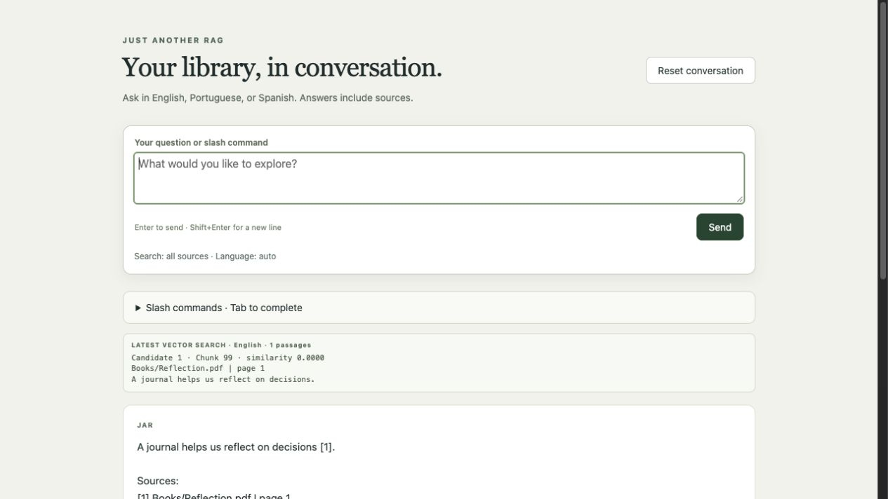
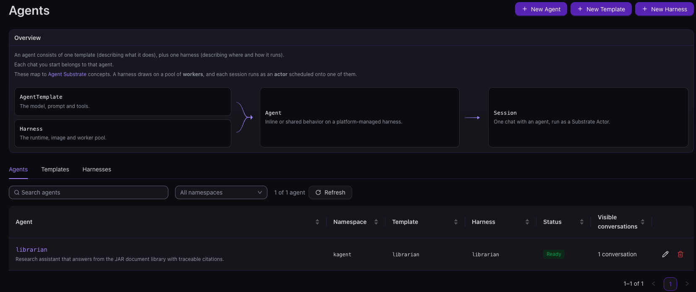

# JAR - Just Another RAG

## Overview

JAR is a multilingual retrieval-augmented generation (RAG) application that recursively indexes **PDF (`.pdf`), Word (`.doc` and `.docx`), and plain-text (`.txt`) files** and answers questions using retrieved evidence with source references.

**JAR in this repository is intended to run as a cloud native application on Kubernetes.** A `jar-index` Job extracts documents and stores passages and embeddings in a separate DuckDB service. A `jar-chat` Deployment serves the browser interface, using OpenAI-compatible chat and embedding services such as KServe. A `jar-mcp` Deployment exposes the same index as read-only Model Context Protocol (MCP) tools for agents such as a [kagent research agent](SETUP.md#4-optional-research-agent-with-kagent). Document converters are included in the index image; inference models run in their own services.

Created by [brito-rafa](https://github.com/brito-rafa) with [OpenAI Codex](https://openai.com/codex/).

Based on the [Kronk RAG example](https://github.com/ardanlabs/kronk/blob/main/examples/rag/main.go) by [Ardan Labs](https://github.com/ardanlabs/kronk). For local inference through Kronk and llama.cpp, including DuckDB Docker Compose setup, use the independent [local-jar repository](https://github.com/brito-rafa/local-jar). Both repositories retain the `cmd/jar-index`, `cmd/jar-chat`, and `pkg/` Go structure and compatible index formats.



*Example interface using synthetic demonstration text, not private documents.*

## Deploy on Kubernetes

Everything runs in the `jar` namespace by default.

1. **Set up DuckDB and KServe.** Follow [SETUP.md](SETUP.md#1-install-kubernetes-services) to deploy DuckDB, install KServe, and serve the chat and embedding models.

2. **Create `.env`.** Copy the example, then set the database token, service URLs, and document paths as described in [SETUP.md](SETUP.md#2-create-and-configure-env):

   ```sh
   cp .env.example .env
   ```

3. **Deploy JAR.** From the repository root, with the intended kubectl context selected:

   ```sh
   make deploy
   ```

   This fills the templates in `config/manifests/kustomize/` from `.env`, writes them to the Git-ignored `config/manifests/generated/`, and applies them. See [SETUP.md](SETUP.md#3-deploy-jar) to follow indexing and open the chat.

4. **Optional: add a research agent.** See [Optional: research agent with kagent](#optional-research-agent-with-kagent) below.

## Optional: research agent with kagent


JAR works without kagent. Adding [kagent](https://kagent.dev) gives end users a second way in: a Librarian research agent next to the everyday `jar-chat`. `jar-chat` answers each question with one fixed retrieval pass. The agent instead decides which read-only `jar-mcp` tools to call (`search_passages`, `list_sources`, `get_passage_context`, `get_conference_text`, `index_status`), can search several times before answering, and the kagent UI shows every tool call. It uses the same Ministral model, embedding model, and DuckDB index, so nothing is re-indexed. With the Tailscale operator installed, `jar-mcp` is also on your tailnet as `http://jarmcp/mcp` for other MCP clients; it has no authentication, so limit it in your tailnet ACLs.

Requirements:

- JAR deployed with `make deploy` (step 3), which also runs `jar-mcp`.
- Kubernetes 1.37 or later serving the beta `certificates.k8s.io/v1beta1` PodCertificateRequest API, which Agent Substrate needs. It is off by default; on minikube, `hack/k8s-setup/01-minikube-start.sh` turns it on.
- Helm, `jq`, `openssl`, and `curl`. The script installs the `kubectl-ate` plugin when it is missing.
- Ministral with at least a 16K context. The agent's first request is already about 8,000 tokens; the KServe example sets `-c 16384 -np 1`.

```sh
bash hack/k8s-setup/05-kagent.sh
kubectl -n kagent apply -f config/manifests/k8s/kagent/example-librarian.yaml
kubectl -n kagent get agents librarian        # wait for Ready
kubectl -n kagent port-forward svc/kagent-ui 8082:8080
```

Open `http://localhost:8082` and choose `librarian`. The Agents page shows it `Ready`, built from the `librarian` template and harness:



If a reply fails, start a new session rather than retrying in the same one: Ministral's chat template rejects a history with two user messages in a row, which a failed turn leaves behind. [SETUP.md](SETUP.md#4-optional-research-agent-with-kagent) covers the PostgreSQL the script installs, the agent's resources, egress, and troubleshooting.

## Import behavior

- Recursively imports `.doc`, `.docx`, `.pdf`, and `.txt`, including uppercase extensions.
- Creates overlapping passages of up to 180 whitespace-separated words with 30 words of overlap. PDF pages are chunked separately; the embedding model's token limit still applies.
- Includes relative filenames and PDF page numbers in context; Word/TXT references use section numbers rather than rendered page numbers.
- Skips symlinks, hidden files/directories, Word lock files, and unsupported formats.
- Password-protected PDFs and documents with no extractable text are skipped with warnings. Scanned/image-only PDFs need OCR before indexing; LibreOffice does not perform OCR.
- Conversion failures stop indexing with the filename and a diagnostic. Legacy Word output containing NUL bytes is rejected or sent through converter fallbacks rather than indexed as binary text.

`-docs` is required for indexing; status, metadata maintenance, and reset do not read documents. Prepared `.chunks` files and the `CHUNKS` Make variable are no longer supported. Pass a directory containing DOC, DOCX, PDF, or TXT files; JAR creates retrieval passages internally.

During an intentional index update, the indexer extracts the corpus and fingerprints its text and embedding configuration. Unchanged indexes are reused without re-embedding the corpus. Changed corpora replace the index in one transaction; the previous committed corpus stays intact if indexing fails. Indexing is **not resumable** in this version: an interrupted new corpus must be indexed again. Use one indexer at a time and finish indexing before starting a chat session, especially when changing the embedding model.

## Chat behavior

English, Portuguese, and Spanish are the primary languages. JAR retrieves multilingual passages, prefers relevant evidence in the question's language, and answers in that language unless `/language` overrides it. Vector results remain visible while the answer is generated.

Answers include numbered citations and source filenames with page or section labels. Invalid citation IDs trigger one retry; personal-name checks are advisory and do not suppress citation-valid answers. Neither check proves factual accuracy—use `/retrieveref` to inspect the evidence.

## Chat commands

Tab completes commands, languages, indexed titles, dates, and reference numbers in the browser and interactive terminal.

| Command | Action |
| --- | --- |
| `/help` | Show all commands |
| `/list books [name]` | List non-conference documents |
| `/list conferences [name or date]` | List conferences |
| `/search book <title or filename>` | Restrict retrieval to matching files |
| `/search date <date>` | Restrict retrieval by filename-derived date |
| `/search clear` | Clear the search filter and conversation |
| `/clearsearch` | Clear only the search filter |
| `/language <language>` | Set `en`, `pt`, `es`, or `auto` detection |
| `/reset` | Clear conversation and search; retain language setting |
| `/retrieveref <number>` | Show a cited passage and download its source context |
| `/retrieve <date>` | Retrieve and download all indexed conference text for a date |
| `/quit` | End the conversation |

Changing a search filter or language clears conversation history and saved references. `/clearsearch` preserves them. Reference numbers belong to the latest answer; vector-search candidate numbers are separate.

`/retrieveref` preserves the exact cited passage. It expands conferences in full and books to detected chapters; unclear chapter boundaries use nearby paragraph/chunk context with an explicit explanation. Downloads retain the original text and append a translation in the query language, skipping translation when the content already confidently matches that language. Model-generated translations may take time and should be checked against the original.

`/retrieve` accepts a year, month, or day (`1958`, `1958-05`, `1958-05-08`), or a legacy date code (`580508`). It joins indexed conference passages in their original language, without changing the conversation or search filter.

### Filename metadata

Titles and dates are inferred from filenames, not verified bibliographic facts. For legacy conference codes, `580508RN.DOC` means `1958-05-08`, `320600CF.DOC` has month precision (`1932-06`), and `3100-1CF.DOC` has year precision (`1931`); these codes assume the 1900s. Unknown dates and abbreviations are not invented. Book filters ignore case and accents and apply before vector ranking.

New indexes include this metadata. See [metadata maintenance](SETUP.md#metadata-maintenance) for existing indexes.

## Attribution and license

Adapted from Kronk's `examples/rag/main.go` and `examples/rag/duck` at revision `50ace045`. The standalone application adds configurable models, recursive document extraction, safe database insertion, separate index/chat commands, and containerized remote storage. Adapted code is distributed under Apache License 2.0; see [LICENSE](LICENSE) and [NOTICE](NOTICE).

## Build and publish application images

If you need your own images, build and publish them before deployment:

```sh
make build
make push
```

Builds default to `PLATFORM=linux/amd64`; use `PLATFORM=linux/arm64` for ARM64 nodes. The default destinations are `ghcr.io/brito-rafa/jar-index:latest`, `ghcr.io/brito-rafa/jar-chat:latest`, and `ghcr.io/brito-rafa/jar-mcp:latest`; override `REGISTRY` and `IMAGE_TAG` to publish under an account you control. Authenticate to the registry first. See [container images](SETUP.md#container-images) for individual image targets, runtime contents, and registry authentication. `make deploy` does not build or push images.

## Troubleshooting and development

Local application commands are troubleshooting and development tools. They require host Go, a C compiler, and access to the configured services; local indexing also needs document converters. Follow the final [troubleshooting and development procedures](SETUP.md#troubleshooting-and-development) for workstation endpoint settings, port forwarding, converter installation, direct CLI/container runs, and maintenance.

```sh
make check-connectivity
make status
make chat
# Or use terminal chat:
make chat-terminal
# Read-only MCP tools on http://127.0.0.1:18090/mcp:
make mcp
```

`make chat` runs the browser interface on your workstation; it does not deploy JAR. For intentional index updates, use the maintenance procedures in SETUP.md and run only one indexer at a time. Native commands and Docker runs are separate from the Kubernetes installation procedure.
