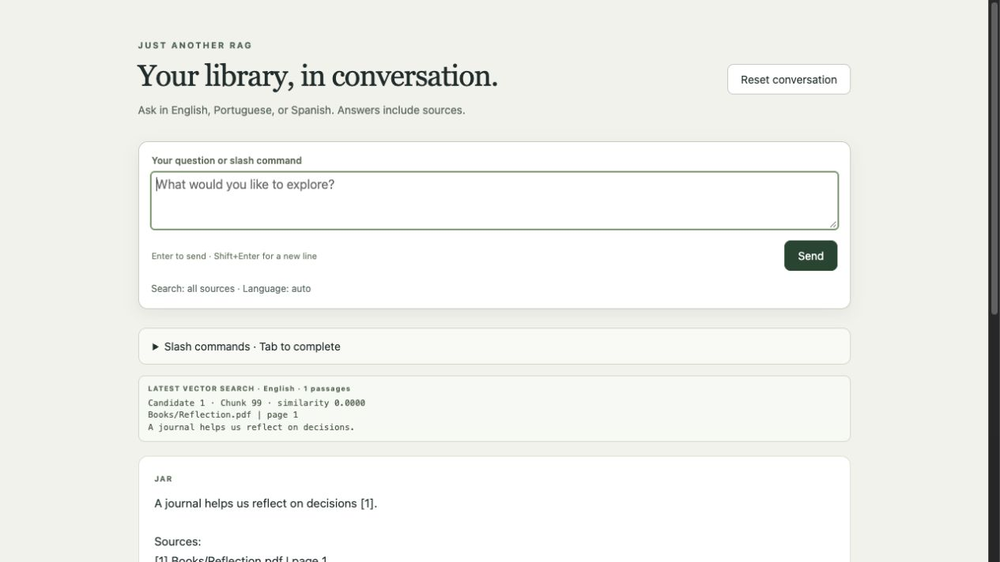

# JAR - Just Another RAG

JAR is a local Go RAG application based on the [Kronk RAG example](https://github.com/ardanlabs/kronk/blob/main/examples/rag/main.go) by [Ardan Labs](https://github.com/ardanlabs/kronk) to run locally for your documents.

## For the Impatients

With Go 1.27.3+, a C compiler, and Docker Desktop running (see [Requirements](#requirements)):

```bash
git clone https://github.com/brito-rafa/jar.git
cd jar
make db-up
make index DOCS="/absolute/path/to/your/documents"
make status
make chat
```

Replace `DOCS` with one or more **existing directories separated by `;`** containing your PDF, DOC, DOCX, or TXT files. For PDFs, install Poppler with `brew install poppler`; Word converter options are below. The first run downloads dependencies and models. `make chat` opens the browser at `http://127.0.0.1:8080`.

`make index` fails immediately if `DOCS` is missing, blank, contains an empty list entry, or any entry is nonexistent or a file rather than a directory. `DOCS` has no default; it can also be explicitly exported in your shell. Chat, help, database setup, status, and metadata commands do not require it.

## Overview

Created by [brito-rafa](https://github.com/brito-rafa) with [OpenAI Codex](https://openai.com/codex/).

JAR is a local Go RAG application based on the [Kronk RAG example](https://github.com/ardanlabs/kronk/blob/main/examples/rag/main.go) by [Ardan Labs](https://github.com/ardanlabs/kronk). Kronk runs models on your Mac through llama.cpp/Metal. DuckDB runs separately in Docker and exposes its [Quack protocol](https://duckdb.org/docs/2.0/quack/overview) over TCP.



*Example interface using synthetic demonstration text, not private documents.*

JAR now has two binaries:

| Command | Responsibility | Models loaded |
| --- | --- | --- |
| `jar-index` | Extract documents, create chunks, and store embeddings | Embedding model only |
| `jar-chat` | Retrieve passages from an existing index and return cited answers | Stored embedding model + selected chat model |

The `jar-index -status` command reads index metadata and chunk count.


## Requirements

- Go 1.27.3 or newer and a C compiler for the DuckDB Go client. On macOS, use native ARM64 Go and install Apple command-line tools with `xcode-select --install` if needed.
- Docker Desktop running, with Compose support.
- Disk space and an initial internet connection for dependencies, models, native libraries, the container image, and DuckDB extensions.

### Document converters on macOS

LibreOffice is not required for JAR itself. Some very old Word files, including Word 2.0 documents such as `HSM.DOC`, need it because other converters can return binary data or incorrect text.

| Input | Converter | Installation |
| --- | --- | --- |
| TXT | Go file reading | None |
| PDF | Poppler `pdftotext` | `brew install poppler` |
| DOCX and most DOC | macOS `textutil` | Included with macOS |
| Legacy DOC | `wvWare` fallback | `brew install wv` |
| DOC still unreadable after those converters | LibreOffice fallback | `brew install --cask libreoffice` |

JAR runs converters locally. LibreOffice is detected through `soffice` on PATH or its standard macOS application path, and runs headlessly with temporary output and a separate temporary profile. Source documents are unchanged. Documents and their extracted text are sent to your configured DuckDB server for storage, not to a cloud model API.

## Quick start

From the JAR directory:

```bash
make help
make db-up
make index DOCS="/absolute/path/to/your/documents"
make status
make chat
```

For example:

```bash
make index DOCS="/Users/brito-rafa/Books"
make status
make chat
```

Index and chat use `go run`, without building a persistent executable. `make run` is now an alias for chat: it does not import documents. `make chat` opens browser chat at `http://127.0.0.1:8080` after loading the models. Press Ctrl+C in the terminal to stop the server.

`make` uses `config/manifests/compose/compose.yaml` with the repository root as the Compose project directory, preserving relative mounts and the existing volume/project names.

`make db-up` ensures the local `./data` directory exists, creates a private, ignored `.env` with a random token and waits for the database health check. The service publishes **127.0.0.1:9494** and persists `/data/jar.db` in the Compose-managed `jar-duckdb` volume. No host database file is mounted. Change `DB_PORT` in `.env` and rerun `make db-up` to select a different host port.

```bash
make db-logs                    # Follow database logs
make db-down                    # Stop the service, preserving its volume
make db-up                      # Start again with stored data intact
```

Do not remove the volume unless you intend to delete its index. `.env` contains the authentication token: do not commit it. Keep the same token for both the server and application commands. The default connection is plain HTTP over loopback TCP; access from another machine requires deliberate port/TLS configuration. The single-user token permits SQL access; chat only issues read queries, but it is not a separate server-enforced read-only role.

## Reset and erase the database

To permanently erase the Compose database volume and start with an empty database:

```bash
make db-reset CONFIRM=erase
```

Without `CONFIRM=erase`, the command refuses to proceed. Stop indexing and chat first. This removes **all data in this Compose project's database volume**, including documents, embeddings, and index metadata; then it starts DuckDB again and waits for readiness. Run `make index DOCS="/path/to/documents"` afterwards to rebuild the index.

The token in `.env`, source documents, cached models, and older host database files are preserved. This target resets the local Compose service, regardless of a `DB_URL` override; it does not erase an arbitrary remote endpoint. Normal `make db-down` preserves data.

## Connection and model settings

| Make variable | Default / purpose |
| --- | --- |
| `GO`, `DOCKER` | Executable overrides; defaults to `go`, `docker` |
| `DB_URL` | `quack:127.0.0.1:9494`, adjusted to `DB_PORT` |
| `DB_PORT` | Published host port; default `9494` |
| `CHAT_PORT` | Local browser chat TCP port; default `8080` |
| `OPEN_BROWSER` | Open the default browser on `make chat`; default `true` |
| `JAR_DB_TOKEN` | Token from `.env`, exported to both commands |
| `DOCS` | Semicolon-separated directories to scan recursively; indexing only |
| `EMBEDDING_MODEL` | `bartowski/granite-embedding-278m-multilingual-GGUF:Q8_0` |
| `DIMENSIONS` | `768`, matching the embedding model output |
| `CHAT_MODEL` | `mistralai/Ministral-3-8B-Instruct-2512-GGUF:Q4_K_M` |

Mistral supplies the chat model; IBM supplies the embedding model, converted to GGUF by bartowski. No Qwen model is selected. Kronk keeps model downloads in its usual `~/.kronk` store, and automatically detects Metal support. Model licenses and converter provenance should be reviewed separately.

### What DIMENSIONS means

`DIMENSIONS` (`-dimensions`) is the number of numeric values in an embedding vector. It must match the embedding model's output: Granite 278M multilingual produces 768 values. It sets the database vector size, not document chunk length, the chat context window, or the number of retrieved passages. Increasing it arbitrarily does not improve quality; a mismatch causes indexing/search errors.

Only indexing takes the embedding settings. Chat reads the stored model identity and dimensions from the server, so document and question vectors use the same model. Changing the embedding configuration requires indexing again.

### Direct commands

Load the generated database token before using Go commands or binaries directly (Make reads `.env` itself):

```bash
export JAR_DB_TOKEN="$(sed -n 's/^JAR_DB_TOKEN=//p' .env)"

go run ./cmd/jar-index -docs "/path/to/documents" -db-url quack:127.0.0.1:9494
go run ./cmd/jar-index -status -db-url quack:127.0.0.1:9494
go run ./cmd/jar-chat -db-url quack:127.0.0.1:9494
```

Use `make build` for `bin/jar-index` and `bin/jar-chat`, or `make cli-help` for all flags. Old combined-command flags such as `-db` and `-docs` on chat are no longer accepted.

## Browser chat

```bash
make chat                       # localhost:8080; open the default browser
make chat CHAT_PORT=8081         # choose a different TCP port
make chat OPEN_BROWSER=false     # start without opening a browser
make chat-terminal              # original terminal chat
```

`CHAT_PORT` defaults to `8080` and `OPEN_BROWSER` to `true`; both can also be set in `.env`. `CHAT_PORT` is separate from the DuckDB `DB_PORT`. Direct command equivalent:

```bash
go run ./cmd/jar-chat -web -port 8080 -open-browser -db-url quack:127.0.0.1:9494
```

For Tailscale Serve or another reverse proxy, configure its exact public origin:

```bash
make chat CHAT_PUBLIC_URL=https://your-machine.your-tailnet.ts.net
```

Or set `CHAT_PUBLIC_URL` in the ignored `.env`. The equivalent CLI flag is `-public-url`. This allows that exact hostname and HTTPS origin through JAR’s Host/Origin checks, including proxies that rewrite the backend Host to loopback. Other external hosts/origins remain rejected. Keep Tailscale Serve forwarding to the local chat port. JAR adds no application login; access is controlled by your proxy/tailnet permissions, and allowed clients share the conversation.

For access through any hostname on all IPv4 interfaces:

```bash
make chat CHAT_HOST=0.0.0.0 CHAT_ALLOW_ANY_HOST=true
```

These settings can be persisted in `.env`; CLI flags are `-host` and `-allow-any-host`. This exposes unauthenticated chat to anyone who can reach the chat port, sharing its conversation and indexed content. Browser requests still require the same origin (or the explicit configured proxy origin); arbitrary cross-origin browser access is not enabled. This does not change firewall, router, or Tailscale settings.

The default listen address remains `127.0.0.1` when `CHAT_HOST` is unset. It opens the browser after models load and the port is successfully bound; a busy port produces an error. The existing database and model requirements still apply. No extra frontend build, Node.js runtime, CDN, or hosted inference service is needed.

The prompt sits above the command help and conversation and stays visible while scrolling. Newest messages appear first, and responses do not automatically scroll the page away from the prompt. The browser displays all slash commands at startup. Enter sends a message, Shift+Enter adds a line, and Tab offers slash commands, book names, conference dates, and reference numbers. Click a completion to insert it. Answers and retrieved passages are displayed as plain text with source labels; document/model HTML is never executed. Vector-search results stream into one compact, scrollable panel with small monospace text as soon as retrieval completes, before answer generation finishes. Each new search replaces that panel instead of adding vector-result cards to the conversation. The panel shows the selected chunk IDs, similarity scores, source labels, short excerpts, and answer language; these are evidence candidates rather than validated answers. Status updates show retrieval, generation, and validation stages. A spinning activity indicator stays visible inside the top prompt throughout the request and disappears on completion or failure; reduced-motion settings disable rotation. Answer drafts remain buffered until citation and name checks finish.

This is a simple local, single-conversation interface: browser tabs share history, search scope, language, and latest references. Closing/reloading a tab does not erase the server conversation, though the visible transcript is not restored after reload. Requests are serialized to protect shared inference contexts. `/quit` clears the conversation but leaves the web server running; use `/reset` to continue. Ctrl+C stops the server and unloads models. `make chat-terminal` retains terminal `/quit` and Ctrl-D behavior.

## Multiple document directories

```bash
make index DOCS="/path/to/books;/path/to/conferences;/path/with spaces"
# Or set this in .env (no shell quotes needed in that file):
# DOCS=/path/to/books;/path/to/conferences;/path/with spaces
```

The same list works with `jar-index -docs "/path/one;/path/two"`. Quote the list on the command line so the shell does not interpret semicolons as commands. Whitespace around entries is trimmed; empty entries (including a trailing `;`) are rejected. A literal semicolon in a directory name is not supported. `.env` is read as Make settings; do not source a file containing an unquoted semicolon list as a shell script. For shell exports, use `export DOCS="/path/one;/path/two"`.

Every directory is validated before indexing starts. Roots are scanned recursively in deterministic order using one shared document-worker pool. Duplicate roots and overlapping file paths are read once. In multi-root imports, source labels include each root's directory name to distinguish identical relative filenames; roots with the same basename get a stable hash suffix. Single-root source labels remain unchanged. All roots feed the same deduplicated database index; include the full desired set of roots on each indexing run.

## Import behavior

- Recursively imports `.doc`, `.docx`, `.pdf`, and `.txt`, including uppercase extensions.
- Creates overlapping passages of up to 180 whitespace-separated words with 30 words of overlap. PDF pages are chunked separately; the embedding model's token limit still applies.
- Includes relative filenames and PDF page numbers in context; Word/TXT references use section numbers rather than rendered page numbers.
- Skips symlinks, hidden files/directories, Word lock files, and unsupported formats.
- Password-protected PDFs and documents with no extractable text are skipped with warnings. Scanned/image-only PDFs need OCR before indexing; LibreOffice does not perform OCR.
- Conversion failures stop indexing with the filename and a diagnostic. Legacy Word output containing NUL bytes is rejected or sent through converter fallbacks rather than indexed as binary text.

`-docs` is required for indexing (except `-status`). Prepared `.chunks` files and the `CHUNKS` Make variable are no longer supported. Pass a directory containing DOC, DOCX, PDF, or TXT files; JAR creates retrieval passages internally.

At startup, the indexer extracts the corpus and fingerprints its text and embedding configuration. Unchanged indexes are reused without loading a model. Changed corpora replace the index in one transaction; the previous committed corpus stays intact if indexing fails. Indexing is **not resumable** in this version: an interrupted new corpus must be indexed again. Use one indexer at a time and finish indexing before starting a chat session, especially when changing the embedding model.

Status reports readiness, chunk count, embedding identity, dimensions, and completion timestamp in UTC. It does not count source documents or maintain a per-file skip history. Runtime warnings identify skipped files.

## Deduplication and concurrent indexing

JAR normalizes passage whitespace and Unicode NFC, hashes the passage body (excluding filenames/page headers), and embeds identical passages only once. Case, punctuation, and accents remain meaningful. Translations and similar-but-different passages are not merged. Every distinct file/page/section location is retained as JSON source metadata on the unique row, so chat can show all origins under one citation instead of presenting duplicate copies as independent evidence.

The deduplicated representation has a new corpus fingerprint version, so the first index run rebuilds the corpus automatically. Resetting first is optional. Existing databases remain readable by chat until you reindex; their duplicate rows are not changed retroactively.

```bash
make index DOCS="/path/to/documents" \
  DOCUMENT_WORKERS=20 \
  EMBEDDING_WORKERS=4 \
  EMBEDDING_BATCH_SIZE=8 \
  INSERT_BATCH_SIZE=128
```

| Setting | Default | Meaning |
| --- | --- | --- |
| `DOCUMENT_WORKERS` | 20 | File conversion/chunking goroutines (1–64) |
| `EMBEDDING_WORKERS` | 4 | Concurrent embedding requests and Kronk sequence/context capacity (1–8) |
| `EMBEDDING_BATCH_SIZE` | 8 | Texts per embedding call (1–128) |
| `INSERT_BATCH_SIZE` | 128 | Unique rows per remote INSERT (1–512) |
| `FORCE_INDEX` | false | Rebuild an unchanged corpus for repeatable comparisons |

File results are combined in deterministic path order. Bounded queues overlap embedding with one database writer; workers are canceled and joined before model unloading on failure. Inserts remain in a single transaction, preserving the previous ready corpus if the replacement fails. Progress reports unique chunks rather than duplicate occurrences, with separate extraction, load, and vector-index timings.

Twenty simultaneous converters can use substantial memory, particularly for LibreOffice. Start at 4 and compare against 20. Two embedding workers do not guarantee twice the GPU throughput: Kronk/llama.cpp control model contexts or sequence batching, and Metal schedules the shared GPU. The best settings depend on passage length, backend, and available memory.

To compare settings on the same corpus without erasing the database, use `FORCE_INDEX=true`. A serial baseline uses all four sizes/counts set to 1. Compare the stage timings, not model download/startup time. Do not benchmark GPU throughput while a chat model is actively answering.

Validation on this Mac: race checks passed; a real Granite run with 20 document workers and 2 embedding workers reduced 8 files to 4 unique rows, and a forced rebuild passed. An isolated database-only check with 512 synthetic two-dimensional vectors took about 1.46 seconds with 512 individual INSERTs versus 0.074 seconds with 4 batched INSERTs. This measures request/write overhead, not an overall RAG or GPU speedup. The small real-model sample did not show a meaningful embedding speed gain from two workers.

## Chat behavior

Chat requires a ready existing remote index. It never scans documents or creates corpus tables. English, Portuguese, and Spanish are the primary supported languages. Chat detects the question's language locally and retrieves the 30 nearest multilingual chunks. It then prioritizes up to two relevant passages in that language and includes up to two relevant passages in other languages. Remaining context slots can be filled from the candidates, up to four passages total. If no same-language evidence is available, other-language evidence remains usable; there is no English-only filter.

Candidate passages more than 0.10 cosine similarity below the best match are not promoted or included. Language detection uses the passage text, excluding its source-header filename, and classifies among the three primary languages. Short or mixed-language text can be misclassified; this is a preference rather than a hard restriction. Preference applies within the 30-candidate pool, not an exhaustive scan of every passage in a language.

The prompt explicitly requests an answer in the detected question language and translation of evidence from other languages, with translated quotations marked and original source filenames retained. Existing indexes work immediately: no language columns, migration, or re-embedding are required. Answers use numbered citations such as `[1]` and `[2]` next to factual claims. JAR prints a Sources section from the retrieved database records, including filenames and PDF page or Word section labels. Older rows without a source label show their database chunk ID and explicitly mark the filename unavailable.

Generation is buffered before display. JAR checks that at least one citation is present and that all recognized citation IDs refer to supplied passages. Missing or invalid citations trigger one retry. Name checks are advisory and do not trigger retries or withhold citation-valid answers. If both drafts fail, JAR withholds the draft, reports that it could not produce valid references, and lists the retrieved sources instead. The source list for a validated answer includes only the cited passages.

The prompt explicitly forbids guessing identities: a role title cannot be equated with a named person unless a supplied passage establishes that identity. Names must come from cited passage text, not the question, prior conversation, filenames, or pretrained knowledge. When identity is unknown, the model must say so and keep the original title. Short names must not be expanded with unsupported surnames, geographic epithets, or biographical identifiers. A one-word query still requests evidence-based information, rather than a pretrained biography. These instructions remain active, but runtime name detection only adds a warning; it does not prevent the answer from being shown.

A local heuristic flags capitalized multiword name candidates (including common name particles) and capitalized names after identity cues or honorifics in English, Portuguese, and Spanish. Candidates must occur in cited passage text, comparing case/accent-insensitively. Generic role titles do not count as personal-name components: phrases such as “Ensinamentos do Autor” are not flagged as people. Explicit work-title contexts and abstract multiword subject phrases (such as translated “Nova Concepção Política”) are excluded from personal-name candidates. The prompt asks for the original title alongside its translation. This classification does not verify a title’s translation or the surrounding factual claim. A warning identifies unsupported name candidates alongside the displayed answer. This does not certify those identities or claims: review the cited evidence. Citation failures remain blocking after one retry; their rejected drafts are not added to conversation history. The vector-search window remains visible regardless of answer validation, and `/retrieveref` remains available for displayed or fallback references.

This heuristic is not complete named-entity recognition or semantic identity verification: it can miss lowercase/single-word names without identity cues and may flag capitalized phrases that are not people. Even a name present in a passage does not prove an asserted identity relationship. These checks do not prove every factual claim or citation is supported; inspect `/retrieveref` for the actual evidence.

No shell or web tools are exposed to the model. Model/library setup and extension installation can make outbound requests; local inference alone is not a network isolation guarantee.

## Chat commands and filename metadata

Enter commands at `USER>`:

```text
/help
/list books
/list conferences 1958
/language pt
/language auto
/retrieve 1958-05-08
/retrieveref 1
/search book Tratado Elemental
/search book HSM
/search date 1958-05-08
/search date 1958-05
/search date 1958
/search date 580508
/reset
/clearsearch
/search clear
/quit
```

`/search book` matches an indexed filename/path or filename-derived title fragment, ignoring case and accents. It lists matching source locations and restricts subsequent questions to those passages. `/search date` accepts a day, month, year, or legacy six-digit conference date. `/search` alone shows the active filter. Changing a filter or using `/search clear` also clears conversation history. `/reset` clears both history and the search filter. `/clearsearch` clears only the search filter, retaining conversation history; previous answers remain in context until `/reset`. Both return retrieval to all sources. A filter with no matches leaves the previous filter and history unchanged. Ordinary questions continue to retrieve multilingual evidence and answer in the question's language.

In an interactive terminal, press **Tab** to complete slash commands, `/list books|conferences`, language codes, book titles/paths, and conference dates. For example, `/he<Tab>` completes `/help`; `/search book La<Tab>` offers matching indexed titles; `/retrieve 1958-<Tab>` offers indexed conference dates. Repeated Tab navigates multiple candidates. Completion is case-insensitive and supports Unicode titles and spaces. Source suggestions require the filename metadata catalog; run `make metadata` if missing. Piped input remains supported without terminal editing, and questions are not saved to an on-disk input-history file.

`/list books [name]` lists distinct non-conference source files with filename-derived titles; this includes documents that cannot be reliably classified as published books. `/list conferences [name or date]` lists conference source files with inferred dates. Filters are optional and match filename/path/title fragments (ignoring case and accents) or ISO date fragments. Lists include all matching files, rather than the 20-location preview used by `/search`, and do not change conversation, language, or the active search scope. `/list` displays usage. Tab completes both list categories and their indexed names/dates.

`/language en`, `/language pt`, and `/language es` override detection for both answer language and source-language preference. English, Portuguese, and Spanish names are also accepted. Evidence in other languages remains available and is translated in generated answers. `/language auto` restores detection; `/language` displays the current setting. Changing the setting clears conversation history while keeping the search filter. `/reset` preserves this language setting.

`/retrieveref 1` displays the exact original-language passage behind `[1]` in the latest displayed Sources list, with its source label and metadata. It uses a saved copy of that passage, so translation never changes the original cited text. Final answer citations are renumbered consecutively from 1 in first-citation order, with the same mapping used by the source list and `/retrieveref`. Interim vector-search candidate numbers are separate. The exact cited passage is followed by scoped source context using exact saved paths and chunk IDs. Conferences expand in full. Other documents expand only within explicit chapter boundaries inferred from indexed `Chapter`/`Capítulo` headings. When chapter boundaries are unclear, JAR returns the cited passage with the immediately preceding and following paragraph where available, staying within the same source file. Existing indexing flattened paragraph breaks: if exact paragraphs cannot be recovered, the adjacent stored chunks are used and this approximation is stated explicitly. Only immediate neighbors are fetched; JAR never falls back to assembling the whole book. Existing indexes do not have authoritative chapter IDs, so this inference can miss headings and fall back conservatively. A **Download reference and context (.txt)** link saves the original material first, then appends a clearly labeled model-generated translation into the language of the query that produced those references (or its explicit `/language` override). The slash command itself is not used for language detection. Before translating, JAR detects the language of the actual source text after removing generated headers/filenames, requires a confident match, and checks separate halves for mixed-language content. If it already matches the requested language, the original is retained with a “translation skipped” notice and no model call or duplicate translation. Individual matching-language translation parts are also retained unchanged. Translation uses the already loaded local chat model in bounded 400-word parts, with a progress counter and spinner. Personal/proper names and source labels are preserved. Unsupported name candidates produce advisory warnings without suppressing the translation; these warnings also appear in the downloaded file. Token-limit failures or empty output still cause the translation to be withheld; the original remains downloadable with an explicit warning and no misleading partial translation. This can take time for large books. Translations are model-generated and should be checked against the retained original. This addresses chunk boundaries that end mid-sentence; it cannot recover text missing from the index. If expansion is unavailable, the exact saved passage is still shown with an explanation. Tab offers available citation IDs. It preserves conversation and filters. A new question replaces the reference list; conversation resets (including filter/language changes that clear history) clear it. `/clearsearch` preserves it. References from earlier answers are not retained.

`/retrieve 1958-05-08` joins every indexed conference passage matching the filename date, grouped by source file and ordered by numeric page/section and chunk ID. Source headers appear once per file. Exact 30-word overlaps introduced by indexing are removed at adjacent chunk boundaries. In the browser, a **Download conference text (.txt)** link above the response saves the joined text as UTF-8; a month/year search includes all matching conference files in one download. It accepts the same date forms as `/search date`: `1958-05-08`, `1958-05`, `1958`, or `580508` (`date` may optionally precede the value). A month or year retrieves all matching conferences. Retrieval ignores the current search filter and leaves that filter and conversation unchanged. It bypasses vector ranking and model generation, retains original source text/language regardless of `/language`, and shows source locations. This is the entire *indexed text*, not a reconstruction of the original file: extraction omissions or overlaps that do not match the known 30-word boundary can remain. Dates are inferred from filenames; an archive date embedded in a book filename does not by itself classify the book as a conference. Run `make metadata` first if the source catalog is missing.

Filters apply in the database before vector ranking, so a relevant book or conference cannot disappear merely because other documents occupy the global top results. Duplicate passages retain all source locations; filtered answers cite the locations that match the filter.

New indexing builds an `item_sources` metadata catalog alongside the embeddings. To add metadata to an existing ready index without rereading documents or regenerating embeddings:

```bash
make metadata
make chat
```

Metadata derives from filenames, not verified bibliographic records. For example, `580508RN.DOC` becomes conference date `1958-05-08`; legacy `YYMMDD` conference codes explicitly assume the 1900s. `320600CF.DOC` records only `1932-06`, and `3100-1CF.DOC` only `1931`. A day-specific filter cannot match a source whose day is unknown. Invalid dates remain unknown. Recognized full dates embedded in filenames are also recorded as inferred dates. Titles replace filename separators with spaces; abbreviations such as `HSM` are retained, not expanded into invented book titles. This metadata is supplied to the model with the passage and source location, with instructions to treat dates and titles as inferred.

## Indexing benchmarks

Local worker/batch benchmark results, when available, are saved under the Git-ignored `benchmarks/` directory. The defaults are 20 document workers, 4 embedding workers, embedding batches of 8, and insert batches of 128. Increasing workers does not guarantee faster indexing; compare settings on your own corpus.

## Existing local database files

Earlier JAR versions stored a file such as `data/jar.db`. These files are preserved, but the new container uses a separate volume. The old metadata lacks a stored embedding model identity, so this workflow requires reindexing into the container once. It does not silently migrate or delete your old index. Do not open the container's file directly from a host process; connect through Quack.

## Implementation and validation

```text
cmd/jar-index/     Index and status entry point
cmd/jar-chat/      Chat entry point
pkg/ingest/  Document extraction and indexing/status command
pkg/chat/    Shared retrieval/conversation engine, terminal and HTTP interfaces
pkg/chat/web/ Browser HTML, CSS, and JavaScript (embedded in jar-chat)
pkg/inference/ Shared local model installation and loading
pkg/connection/ Shared database connection flags
pkg/duck/         Remote queries, index metadata, vector search
hack/duck/        DuckDB CLI server initialization
config/manifests/compose/compose.yaml  Persistent database service
```

The Go client uses an in-memory DuckDB connection with Quack attached. All application SQL executes on the server through `jar_remote.query`. This avoids an internal error encountered with DuckDB 2.0's `CONNECT` path through Go's prepared-statement API. The outer query is parameterized; inner text values are encoded as base64 expressions and vectors as validated finite numeric literals, so source text cannot become SQL syntax.

```bash
make test
make vet
```

Converter tests skip when their tools are unavailable. Optional network integration tests require the running service and the token:

```bash
export JAR_DB_TOKEN="$(sed -n 's/^JAR_DB_TOKEN=//p' .env)"
JAR_TEST_REMOTE=1 go test ./pkg/duck -run TestRemote -v
```

Verified on this Apple Silicon Mac: sample indexing with Granite only, status without models, Spanish chat through the remote index, authentication rejection, Unicode/NUL roundtrips, transaction rollback, container restart persistence, unchanged-index reuse, empty-index chat rejection, and explicit database reset in an isolated Compose project. Unit tests, Go vet, staticcheck, and command builds pass.

For an optional local-model check of an English answer with multilingual context:

```bash
JAR_LIVE_CHAT_TEST=1 go test ./pkg/chat -run TestLiveEnglishMultilingualContext -v
```

This opt-in test loads the local chat model; ordinary tests do not.

## Attribution and license

Adapted from Kronk's `examples/rag/main.go` and `examples/rag/duck` at revision `50ace045`. The standalone application adds configurable models, recursive document extraction, safe database insertion, separate index/chat commands, and containerized remote storage. Adapted code is distributed under Apache License 2.0; see [LICENSE](LICENSE) and [NOTICE](NOTICE).
